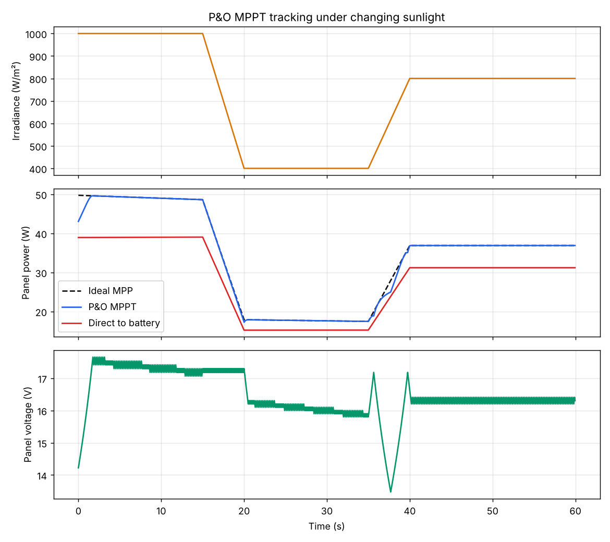
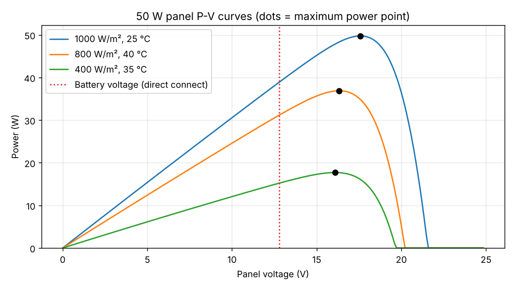

# Solar MPPT Charge Controller

A **50 W solar charge controller** that uses a synchronous buck converter and the **Perturb & Observe (P&O)** algorithm to keep a solar panel at its maximum power point while charging a 12 V lead-acid battery in bulk, absorb and float stages.

**Live demo:** https://mahendr99ar.github.io/solar-mppt-charge-controller/ (drag the sunlight and temperature sliders and watch the tracker follow the peak)


## Results (simulation)

60 s of changing weather on a model of a 50 W panel (full sun → passing cloud → partial recovery, panel warming 25 °C → 40 °C):

| Metric | Value |
| --- | --- |
| Tracking efficiency (energy vs ideal MPP) | **99.5 %** |
| Extra energy vs panel wired straight to the battery | **+20.3 %** |
| Lock-on time from a bad start (to 98 %) | 1.3 s |



Around 36 s the voltage swings while irradiance is rising: power goes up because of the sun, not the last step, so P&O briefly walks the wrong way. This is a known P&O limitation; it recovers as soon as the light settles. Incremental-conductance or a smaller step size would reduce it.

## How it works

```
 Solar panel ──► Synchronous buck (IR2104 + 2× IRFZ44N, 220 µH) ──► 12 V battery
   15–22 V               ▲ PWM 31.25 kHz                              12–14.4 V
     │ V, I              │
     └──────────► Arduino Nano (P&O MPPT, charging stages, LCD) ◄── battery V
```

In a buck converter, `Vpanel ≈ Vbattery / D`. So changing the duty cycle **D** moves the panel's operating voltage. Every 50 ms the firmware:

1. measures panel voltage and current and computes power;
2. steps the duty cycle by 0.5 %;
3. keeps going the same direction if power rose, reverses if it fell.

### Charging stages

| Stage | Condition | Action |
| --- | --- | --- |
| Bulk | Battery below 14.4 V | P&O MPPT, all available power to the battery |
| Absorb | Battery reaches 14.4 V | Hold 14.4 V (constant voltage) |
| Float | Charge current below 0.3 A | Hold 13.8 V |
| Night | Panel below battery + 0.5 V | Converter off |

## Design

```bash
python3 model/pv_model.py        # panel model check against datasheet
python3 design/buck_design.py    # inductor, capacitors, duty cycle
python3 simulation/mppt_sim.py   # P&O simulation, writes plots + results.txt
```

| Part | Value | Reason |
| --- | --- | --- |
| Panel model | Single-diode, 36 cells: Vmp 17.6 V, Imp 2.83 A, Pmp 49.7 W | Matches a typical 50 W datasheet |
| Switching frequency | 31.25 kHz | Arduino Timer1 (16 MHz / 512) |
| Duty at MPP | 0.78 | 13.8 V / 17.6 V |
| Inductor | 220 µH, ≥ 5.2 A saturation | ~30 % ripple at 22 V input |
| Output capacitor | 100 µF / 25 V low-ESR | < 50 mV ripple |
| Input capacitor | 470 µF / 35 V low-ESR | 1.5 A RMS ripple current |
| Switches | 2 × IRFZ44N + IR2104 | Synchronous buck, low conduction loss |
| Blocking diode | MBR1045 | Prevents night-time reverse current |



## Firmware

`firmware/mppt_controller/mppt_controller.ino` (Arduino Nano). Needs the **LiquidCrystal_I2C** library.

| Pin | Connection |
| --- | --- |
| A0 | Panel voltage divider (47 k / 10 k) |
| A1 | Battery voltage divider (47 k / 10 k) |
| A2 | ACS712-05B current sensor output |
| D9 | PWM to IR2104 IN (Timer1, 31.25 kHz) |
| D8 | IR2104 SD (driver enable) |
| A4 / A5 | I2C LCD SDA / SCL |

The serial port (115200 baud) prints `Vpv, Ipv, Ppv, Vbat, duty, stage` every 0.5 s for logging.

## Bill of materials

| Part | Qty |
| --- | --- |
| Arduino Nano | 1 |
| IR2104 half-bridge driver | 1 |
| IRFZ44N MOSFET | 2 |
| 220 µH, 5 A power inductor | 1 |
| 470 µF / 35 V and 100 µF / 25 V low-ESR capacitors | 1 each |
| ACS712-05B current sensor module | 1 |
| MBR1045 Schottky diode | 1 |
| 47 kΩ and 10 kΩ resistors | 2 each |
| 16×2 I2C LCD | 1 |
| 1N4148 + 1 µF (bootstrap), 10 Ω gate resistors | — |
| 50 W solar panel, 12 V 7 Ah lead-acid battery, fuses | 1 each |

## Website

The project page lives in `docs/` and is served by GitHub Pages. The interactive tracker runs the same panel model and P&O logic as the Python simulation, in JavaScript.

## Repository layout

```
model/pv_model.py                      single-diode solar panel model
design/buck_design.py                  buck converter component design
simulation/mppt_sim.py                 P&O simulation, plots, results.txt
firmware/mppt_controller/*.ino         Arduino firmware
docs/                                  project website (GitHub Pages)
```

## Contributors
- [Mahendra Meena](https://github.com/Mahendr99ar)
- [Kiran Meena](https://github.com/Kirann260)
